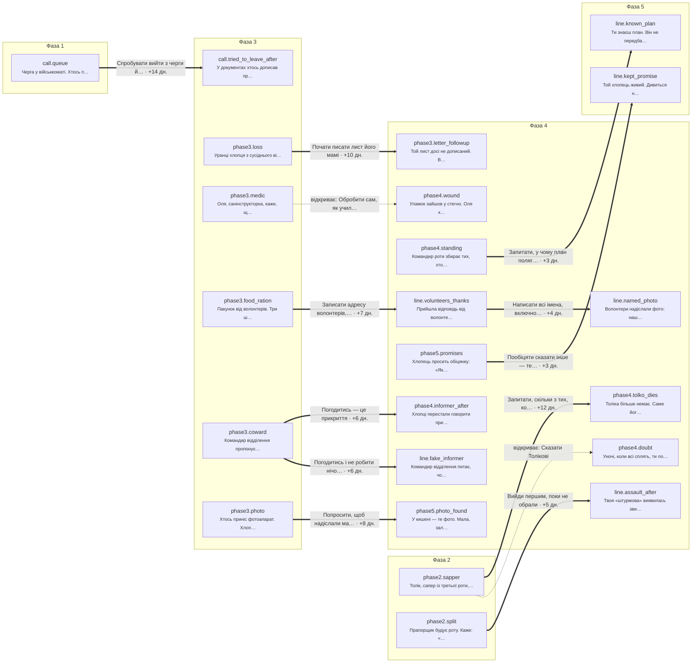

# Дерево подій

Генерується з контенту: `npm run tree`. Інтерактивна картинка з усіма 76 картками — [event-tree.html](event-tree.html).

- **Товста стрілка** — `next`: вибір гарантовано веде до події (іноді через N днів).
- **Тонка** — вчинок відкриває картку (`requires.flagTrue`).
- **Пунктир** — вчинок відкриває варіант на іншій картці.
- Echo-зв’язки (м’які спогади) показані лише на картинці.

Кожна картка показується **не більше одного разу за забіг**, тож дерево не повторюється, а гілка або спрацьовує, або ні.

